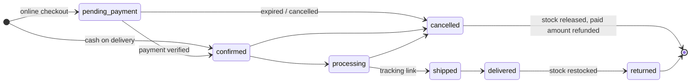

<div align="center">


<br/>

[](https://github.com/Swarup2608/Eccomerce-MERN-AI/actions/workflows/ci.yml)


**A production-style e-commerce platform: a customer storefront, an admin console and a hardened REST API, in one TypeScript monorepo.**

[Features](#-features) · [Architecture](#-architecture) · [Engineering highlights](#-engineering-highlights) · [Getting started](#-getting-started) · [Testing](#-testing) · [Roadmap](#-roadmap)


</div>

---

## ✨ Features

<table>
<tr>
<td width="50%" valign="top">

### 🛍️ Storefront
- Home, product listing with **category filters and sorting**
- Product pages with an image gallery
- **Sales and offers** page
- Guest cart in the browser that moves to the server when you sign in
- Wishlist and address book
- Checkout with **Razorpay, Stripe or Cash on Delivery**
- Order history, order tracking and cancellation
- Register, **email verification**, login by email or username
- Forgot / reset / change password, optional **email-OTP MFA**

</td>
<td width="50%" valign="top">

### 🧭 Admin console
- **Dashboard**: orders today, 30-day revenue, daily revenue chart
- **Categories** with their own product attributes
- **Products** with images uploaded straight from the browser to Cloudflare R2
- **Orders**: status workflow, tracking links, refunds
- **Customers**: list and detail view
- **Sales engine**: percent or fixed discounts for the whole catalog, chosen categories or chosen products, with start and end scheduling
- Every admin login needs an **emailed one-time code**, plus an optional IP allow-list

</td>
</tr>
</table>

---

## 🏗️ Architecture


Three apps share one npm-workspaces monorepo:

| App | Path | Stack | Port |
|---|---|---|---|
| **REST API** | [`backend/`](backend) | Express 5 · Mongoose 9 · ioredis · Zod 4 · argon2 · Helmet | `4000` |
| **Storefront** | [`storefront/`](storefront) | Next.js 16 (App Router, Turbopack) · React 19 · Tailwind 4 | `3000` |
| **Admin** | [`admin/`](admin) | Next.js 16 · React 19 · Tailwind 4 | `3001` |

---

## 🧠 Engineering highlights

### Checkout you can't break by double-clicking


- **Prices always come from the database.** The cart is re-priced on every read, and the client never sends a price.
- **Money is stored as integer paise.** No floating-point rounding errors.
- **Stock is reserved atomically**, one conditional `$inc` per line. Either every line is reserved or none is, and stock is released at most once.
- **Idempotent orders.** A client-generated key plus a unique `(user, idempotencyKey)` index means a retry returns the same order.
- **Payments are verified on the server.** Razorpay HMAC is compared in constant time and the capture is re-checked with Razorpay. Stripe webhooks go through `constructEvent`. Each webhook event is processed once, and the amount and currency are checked.
- **A payment that arrives after an order was cancelled is refunded automatically.**
- **Unpaid online orders expire**, and their stock is released. A Redis lock makes sure only one API instance runs the sweep.

### Order lifecycle



### Security

| Threat | Defense |
|---|---|
| **Token theft (XSS)** | Tokens live only in `HttpOnly`, `Secure`, `SameSite=Strict` cookies; a **nonce-based CSP with `strict-dynamic`** on both Next.js apps; the API's own CSP is `default-src 'none'` |
| **Stolen refresh tokens** | **Rotation with reuse detection**, done as one atomic **Redis Lua** compare-and-swap. A replayed token ends the session |
| **Stale sessions** | Every request checks the session in Redis and the account status. Logout and bans take effect immediately |
| **Customer → admin escalation** | Separate JWT secrets, audiences, cookie names and cookie paths for each scope |
| **CSRF** | SameSite=Strict, an Origin allow-list on state-changing requests, JSON-only request bodies |
| **NoSQL injection** | Zod `.strict()` schemas, Mongoose `sanitizeFilter`, rejection of `$`, dotted and `__proto__` keys |
| **Password cracking** | **argon2id** hashing, a password policy and a blocklist of common passwords |
| **Account enumeration** | Neutral responses that take the same time whether or not the account exists |
| **Brute force and abuse** | Redis rate limiting (a global limit plus a stricter auth limit), lockouts, OTP retry caps |
| **Misconfiguration** | Environment validated with **Zod** at boot. Production requires HTTPS origins and distinct secrets of 32+ characters |
| **Malicious uploads** | **Presigned R2 PUTs** that bind the content type and size; orphaned uploads are cleaned up |
| **Forensics** | A typed **audit trail** of security and commerce events in MongoDB, plus structured JSON logs that redact secrets |

<details>
<summary><b>📁 Project structure</b> (click to expand)</summary>

```text
.
├── backend/                 Express 5 REST API
│   └── src/
│       ├── config/          Zod-validated environment
│       ├── lib/             logger, mailer, mongo, redis, storage (R2)
│       ├── middleware/      authenticate, authorize, rate-limit, security, sanitize, cache
│       ├── modules/
│       │   ├── auth/        login, register, MFA, reset, cookies, policies
│       │   ├── catalog …    categories, products, stock, sales, uploads
│       │   ├── cart/ orders/ payments/ (razorpay, stripe, webhooks)
│       │   └── admin/ audit/ addresses/ wishlist/ users/
│       ├── scripts/         seed and maintenance CLIs
│       └── tests/           integration and unit tests (real Mongo + Redis)
├── storefront/              Next.js customer app
├── admin/                   Next.js admin console
├── docs/readme/             animated README graphics
└── .github/                 CI workflow and Dependabot
```

</details>

---

## 🚀 Getting started

### Prerequisites
- **Node.js ≥ 22.12**
- **MongoDB** (local, or a free Atlas cluster)
- **Redis** (local, or a free Redis Cloud / Upstash instance)

### 1. Install

```bash
git clone https://github.com/Swarup2608/Eccomerce-MERN-AI.git
cd Eccomerce-MERN-AI
npm install
```

### 2. Configure

```bash
cp backend/.env.example backend/.env
cp storefront/.env.example storefront/.env.local
cp admin/.env.example admin/.env.local
```

In `backend/.env`, set at least `MONGODB_URI`, `REDIS_URL`, `ACCESS_TOKEN_SECRET` and `ADMIN_ACCESS_TOKEN_SECRET`. Generate each secret with:

```bash
node -e "console.log(require('node:crypto').randomBytes(48).toString('base64url'))"
```

<details>
<summary><b>Optional integrations</b></summary>

| Integration | Variables | Without it |
|---|---|---|
| Email (SMTP) | `SMTP_HOST`, `SMTP_PORT`, `SMTP_USER`, `SMTP_PASS`, `EMAIL_FROM` | In development, emails (verification links, OTP codes) are **printed to the API log** |
| Image uploads (Cloudflare R2) | `R2_ACCOUNT_ID`, `R2_ACCESS_KEY_ID`, `R2_SECRET_ACCESS_KEY`, `R2_BUCKET`, `R2_PUBLIC_URL` | Uploads are turned off |
| Razorpay | `RAZORPAY_KEY_ID`, `RAZORPAY_KEY_SECRET`, `RAZORPAY_WEBHOOK_SECRET` | Hidden at checkout |
| Stripe | `STRIPE_SECRET_KEY`, `STRIPE_WEBHOOK_SECRET` | Hidden at checkout |

Cash on Delivery is always available. To test Stripe webhooks locally:
`stripe listen --forward-to localhost:4000/api/v1/webhooks/stripe`

</details>

### 3. Seed and run

```bash
# create the admin account (password: 12+ chars with upper, lower, number and symbol)
SEED_ADMIN_EMAIL=you@example.com SEED_ADMIN_PASSWORD='Str0ng!Passw0rd' npm run seed:admin

# optional: demo categories and products
npm run seed:catalog

# start the API, storefront and admin together
npm run dev
```

| App | URL |
|---|---|
| Storefront | http://localhost:3000 |
| Admin | http://localhost:3001 (the login code shows up in the API log when SMTP isn't set) |
| API health | http://localhost:4000/health/live |

### Scripts

| Command | What it does |
|---|---|
| `npm run dev` | Runs all three apps with live reload |
| `npm run build` | Production build of every workspace |
| `npm run lint` / `npm run typecheck` | ESLint / TypeScript across the monorepo |
| `npm test` | Backend test suite |
| `npm run audit:prod` | `npm audit` for production dependencies |
| `npm run seed:admin` / `reset:admin` | Create or reset the admin account |
| `npm run unblock:user` | Lift a lockout on an account |
| `npm run seed:catalog` | Load demo catalog data |
| `npm run cleanup:uploads` | Delete images that were uploaded but never attached to a product |
| `npm run r2:cors` | Apply the CORS rule the R2 bucket needs for browser uploads |

---

## 🧪 Testing

```bash
npm test
```

- **127 tests in 36 suites**, run against **real MongoDB and Redis**, not mocks. Locally, the harness starts its own `mongod` and `redis-server`; in CI it uses service containers.
- Payment gateways are replaced with fakes, so the payment and webhook paths run without network calls.
- Coverage: auth flows (register, verify, login, MFA, reset, rotation, lockout), catalog, cart and shopper journeys, orders, payments, sales, tokens and app-level security.

**CI** ([`.github/workflows/ci.yml`](.github/workflows/ci.yml)) runs on every push to `master` and on every pull request: `lint → typecheck → test (Mongo 7 + Redis 7) → npm audit`. Dependabot keeps dependencies up to date.

---

## 🗺️ Roadmap

- [ ] Playwright end-to-end tests for checkout, plus accessibility checks
- [ ] Cloudflare Turnstile on register, login and checkout; progressive login throttling
- [ ] TOTP and passkeys for admins; staff roles (RBAC)
- [ ] Coupons, product reviews, a returns workflow and GST tax invoices
- [ ] Per-customer open-order limits and a configurable COD limit
- [ ] Background job queue (BullMQ) for order expiry and emails
- [ ] Optimized images, `sitemap.xml` and JSON-LD product data
- [ ] Docker Compose setup and a public live demo

---

<div align="center">

Built by **[Swarup2608](https://github.com/Swarup2608)** with TypeScript, Next.js, Express, MongoDB and Redis.

⭐ If this project helped you, consider giving it a star.

</div>
