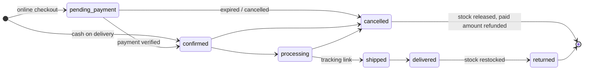
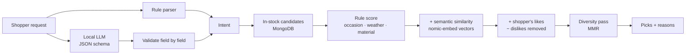

<div align="center">



<br/>

[](https://github.com/Swarup2608/Eccomerce-MERN-AI/actions/workflows/ci.yml)


**A production-style e-commerce platform: a customer storefront, an admin console, a hardened REST API and a local-LLM AI stylist, in one TypeScript monorepo.**

[Features](#-features) · [Architecture](#-architecture) · [Engineering highlights](#-engineering-highlights) · [AI stylist](#-ai-stylist) · [Getting started](#-getting-started) · [Testing](#-testing) · [Roadmap](#-roadmap)


</div>

---

## ✨ Features

<table>
<tr>
<td width="50%" valign="top">

### 🛍️ Storefront
- Home, product listing with **category filters and sorting**
- Product pages with an image gallery
- **Sales and offers** page
- Guest cart in the browser that moves to the server when you sign in
- Wishlist and address book
- Checkout with **Razorpay, Stripe or Cash on Delivery**
- Order history, order tracking and cancellation
- Register, **email verification**, login by email or username
- Forgot / reset / change password, optional **email-OTP MFA**

</td>
<td width="50%" valign="top">

### 🧭 Admin console
- **Dashboard**: orders today, 30-day revenue, daily revenue chart
- **Categories** with their own product attributes
- **Products** with images uploaded straight from the browser to Cloudflare R2
- **Orders**: status workflow, tracking links, refunds
- **Customers**: list and detail view
- **Sales engine**: percent or fixed discounts for the whole catalog, chosen categories or chosen products, with start and end scheduling
- Every admin login needs an **emailed one-time code**, plus an optional IP allow-list

</td>
</tr>
<tr>
<td colspan="2" valign="top">

### 🪄 AI stylist
- **Ask the stylist**: outfit picks from the shop, from your own wardrobe, or your wardrobe plus shop add-ons, tuned to the **occasion, budget and the weather** where you'll be. Pick "Other" to describe an occasion in your own words
- **Chat**: a tool-using shopping agent that searches the real catalog, checks stock and weather, shows what it is doing as it works, and only ever recommends in-stock products
- **My wardrobe**: photograph and tag the clothes you own
- **More like this / Not for me** feedback that personalises later picks
- Runs on **free, local models through Ollama**; if the model is down or slow, every feature falls back to rule-based results

</td>
</tr>
</table>

---

## 🏗️ Architecture



Four apps share one npm-workspaces monorepo:

| App | Path | Stack | Port |
|---|---|---|---|
| **REST API** | [`backend/`](backend) | Express 5 · Mongoose 9 · ioredis · Zod 4 · argon2 · Helmet | `4000` |
| **Storefront** | [`storefront/`](storefront) | Next.js 16 (App Router, Turbopack) · React 19 · Tailwind 4 | `3000` |
| **Admin** | [`admin/`](admin) | Next.js 16 · React 19 · Tailwind 4 | `3001` |
| **AI stylist** | [`stylist-node/`](stylist-node) | Node 22 `http` · MongoDB driver · Ollama · Open-Meteo | `4100` |

The stylist is a separate, mostly read-only service. It reads the catalog from the shop's MongoDB, and it recognises signed-in shoppers from the API's own access cookie, so there is no second login. It writes only to its own collections (wardrobe, feedback, product vectors).

---

## 🧠 Engineering highlights

### Checkout you can't break by double-clicking



- **Prices always come from the database.** The cart is re-priced on every read, and the client never sends a price.
- **Money is stored as integer paise.** No floating-point rounding errors.
- **Stock is reserved atomically**, one conditional `$inc` per line. Either every line is reserved or none is, and stock is released at most once.
- **Idempotent orders.** A client-generated key plus a unique `(user, idempotencyKey)` index means a retry returns the same order.
- **Payments are verified on the server.** Razorpay HMAC is compared in constant time and the capture is re-checked with Razorpay. Stripe webhooks go through `constructEvent`. Each webhook event is processed once, and the amount and currency are checked.
- **A payment that arrives after an order was cancelled is refunded automatically.**
- **Unpaid online orders expire**, and their stock is released. A Redis lock makes sure only one API instance runs the sweep.

### Order lifecycle



### Security

| Threat | Defense |
|---|---|
| **Token theft (XSS)** | Tokens live only in `HttpOnly`, `Secure`, `SameSite=Strict` cookies; a **nonce-based CSP with `strict-dynamic`** on both Next.js apps; the API's own CSP is `default-src 'none'` |
| **Stolen refresh tokens** | **Rotation with reuse detection**, done as one atomic **Redis Lua** compare-and-swap. A replayed token ends the session |
| **Stale sessions** | Every request checks the session in Redis and the account status. Logout and bans take effect immediately |
| **Customer → admin escalation** | Separate JWT secrets, audiences, cookie names and cookie paths for each scope |
| **CSRF** | SameSite=Strict, an Origin allow-list on state-changing requests, JSON-only request bodies |
| **NoSQL injection** | Zod `.strict()` schemas, Mongoose `sanitizeFilter`, rejection of `$`, dotted and `__proto__` keys |
| **Password cracking** | **argon2id** hashing, a password policy and a blocklist of common passwords |
| **Account enumeration** | Neutral responses that take the same time whether or not the account exists |
| **Brute force and abuse** | Redis rate limiting (a global limit plus a stricter auth limit), lockouts, OTP retry caps |
| **Misconfiguration** | Environment validated with **Zod** at boot. Production requires HTTPS origins and distinct secrets of 32+ characters |
| **Malicious uploads** | **Presigned R2 PUTs** that bind the content type and size; orphaned uploads are cleaned up |
| **Forensics** | A typed **audit trail** of security and commerce events in MongoDB, plus structured JSON logs that redact secrets |

<details>
<summary><b>📁 Project structure</b> (click to expand)</summary>

```text
.
├── backend/                 Express 5 REST API
│   └── src/
│       ├── config/          Zod-validated environment
│       ├── lib/             logger, mailer, mongo, redis, storage (R2)
│       ├── middleware/      authenticate, authorize, rate-limit, security, sanitize, cache
│       ├── modules/
│       │   ├── auth/        login, register, MFA, reset, cookies, policies
│       │   ├── catalog …    categories, products, stock, sales, uploads
│       │   ├── cart/ orders/ payments/ (razorpay, stripe, webhooks)
│       │   └── admin/ audit/ addresses/ wishlist/ users/
│       ├── scripts/         seed and maintenance CLIs
│       └── tests/           integration and unit tests (real Mongo + Redis)
├── storefront/              Next.js customer app
├── admin/                   Next.js admin console
├── stylist-node/            AI stylist service
│   ├── src/
│   │   ├── server.ts        routes, auth, per-shopper throttling
│   │   ├── scoring.ts       rule score: occasion, weather, material, size
│   │   ├── outfits.ts       /suggest: shop picks, wardrobe outfits, add-ons
│   │   ├── intent.ts        free text → occasion, budget, colours, gender, city
│   │   ├── embeddings.ts    product vectors (npm run embed)
│   │   ├── hybrid.ts        rules + semantic + likes, then a diversity pass
│   │   ├── chat.ts          tool-calling chat agent with output checks
│   │   ├── llm.ts           thin Ollama client
│   │   ├── feedback.ts      likes and dislikes
│   │   ├── metrics.ts       counters, latency percentiles, JSON logs
│   │   └── eval-cli.ts      offline intent evaluation (npm run eval)
│   └── test/
├── docs/readme/             animated README graphics
└── .github/                 CI workflow and Dependabot
```

</details>

---

## 🪄 AI stylist

The stylist is built so that **the model can make results better but can never make them wrong**. Prices, stock, product ids and totals always come from code and the database, never from model text.



- **Intent extraction with guard rails.** The keyword parser always runs. The local model refines it through a JSON schema, and its answer is checked field by field against allowed values, so a malformed or hostile answer can only lose information, never inject it. An exact budget or colour stated in the text beats the model's reading.
- **Hybrid ranking.** The rule score (occasion, temperature band, rain, fabric, sizes in stock) is combined with cosine similarity between the request and product embeddings, plus a nudge toward the centroid of products the shopper liked. A maximal-marginal-relevance pass then stops near-identical items from filling the list. Disliked products never appear.
- **Embeddings without a vector database.** Each active product is embedded once and stored in `stylist_product_vectors`, keyed by a content hash, so only new or edited products are sent to the model. The service re-checks the catalog every 15 minutes, and removed products are dropped from the index so they can never surface. A few hundred products are compared in memory. If there is no index, ranking uses rules only.
- **A chat agent that can't invent products.** The model calls four tools (`searchProducts`, `getWeather`, `checkInventory`, `getPreferences`) that run in our code. The answer is then post-processed: any product id that didn't come from a tool result is dropped, and the outfit total and the over-budget warning are computed in code. Tool output is treated as data, not instructions. Asking "for women or men?" is enforced in code rather than left to the prompt, because the small model skipped it.
- **Streaming that never shows unchecked text.** The chat streams newline-delimited JSON: live status lines ("Searching the shop for "linen shirt"", "Checking the weather in Goa") while the agent works, then the validated answer. Model text is not streamed token by token, because it has to pass the id and budget checks first.
- **A hard deadline.** The agent loop, including its tool calls, races a 35-second deadline and has at most 5 steps. When it runs out, a rule-only fallback answers in well under a second, so the shopper never waits past the browser's timeout.
- **Optional written summary.** On request, the model rephrases the validated top picks in two sentences. It never sees or produces prices or ids, and a template summary is used if it fails.
- **Observability.** Structured JSON logs and an in-memory `GET /metrics` with counters (LLM calls, tokens, fallbacks, invalid ids) and p50/p95 latency.
- **Measured, not guessed.** Two offline evals, run on a laptop with `qwen3:4b-instruct`:
  - `npm run eval:stylist` scores intent extraction on 12 labelled requests: **60/60** fields with the model versus **53/60** for rules alone, at about 1.4 s per request.
  - `npm run eval:stylist:chat` runs the agent on 7 scenarios against the real catalog, including a prompt-injection attempt and a request with no gender. It checks every answer against the database: products are real and in stock, within budget, from the right section, no invented ids, and it asks when unsure. **All checks pass**, with a median of about 6.5 s per reply.

  These evals have already caught real bugs: the agent skipping the gender question, a "Diwali puja" read as religious, and one reply that took 52 s before the hard deadline existed.

| Endpoint | Auth | What it does |
|---|---|---|
| `POST /api/v1/stylist/suggest` | shopper | Shop picks, wardrobe outfits or wardrobe + add-ons |
| `POST /api/v1/stylist/chat` | shopper | Chat agent (12 requests/min per shopper). Send `Accept: application/x-ndjson` to stream progress lines, then the result |
| `POST /api/v1/stylist/feedback` | shopper | `like`, `dislike` or `clear` for a product |
| `GET/POST/DELETE /api/v1/stylist/wardrobe` | shopper | Wardrobe items |
| `POST /recommend` | none | Stateless dress recommendations by weather and occasion |
| `GET /health` · `GET /metrics` | none | Liveness and counters |

---

## 🚀 Getting started

### Prerequisites
- **Node.js ≥ 22.12**
- **MongoDB** (local, or a free Atlas cluster)
- **Redis** (local, or a free Redis Cloud / Upstash instance)
- Optional: **[Ollama](https://ollama.com)** for the stylist's AI features (the stylist works without it, using rules only)

### 1. Install

```bash
git clone https://github.com/Swarup2608/Eccomerce-MERN-AI.git
cd Eccomerce-MERN-AI
npm install
```

### 2. Configure

```bash
cp backend/.env.example backend/.env
cp storefront/.env.example storefront/.env.local
cp admin/.env.example admin/.env.local
cp stylist-node/.env.example stylist-node/.env
```

In `backend/.env`, set at least `MONGODB_URI`, `REDIS_URL`, `ACCESS_TOKEN_SECRET` and `ADMIN_ACCESS_TOKEN_SECRET`. In `stylist-node/.env`, use the **same** `MONGODB_URI`, database name and `ACCESS_TOKEN_SECRET` as the backend. Generate each secret with:

```bash
node -e "console.log(require('node:crypto').randomBytes(48).toString('base64url'))"
```

<details>
<summary><b>Optional integrations</b></summary>

| Integration | Variables | Without it |
|---|---|---|
| Email (SMTP) | `SMTP_HOST`, `SMTP_PORT`, `SMTP_USER`, `SMTP_PASS`, `EMAIL_FROM` | In development, emails (verification links, OTP codes) are **printed to the API log** |
| Image uploads (Cloudflare R2) | `R2_ACCOUNT_ID`, `R2_ACCESS_KEY_ID`, `R2_SECRET_ACCESS_KEY`, `R2_BUCKET`, `R2_PUBLIC_URL` | Uploads are turned off |
| Razorpay | `RAZORPAY_KEY_ID`, `RAZORPAY_KEY_SECRET`, `RAZORPAY_WEBHOOK_SECRET` | Hidden at checkout |
| Stripe | `STRIPE_SECRET_KEY`, `STRIPE_WEBHOOK_SECRET` | Hidden at checkout |

Cash on Delivery is always available. To test Stripe webhooks locally:
`stripe listen --forward-to localhost:4000/api/v1/webhooks/stripe`

</details>

<details>
<summary><b>AI stylist (local models, free)</b></summary>

| Variable | Default | Purpose |
|---|---|---|
| `OLLAMA_URL` | `http://localhost:11434` | Ollama server |
| `STYLIST_CHAT_MODEL` | `qwen3:4b-instruct` | Intent extraction, chat agent, summaries |
| `STYLIST_EMBED_MODEL` | `nomic-embed-text` | Product and query embeddings |
| `STYLIST_LLM_TIMEOUT_MS` | `20000` | Per-call timeout before falling back to rules |
| `STYLIST_REINDEX_MINUTES` | `15` | How often new or edited products are embedded (`0` turns it off) |
| `STYLIST_ACCESS_COOKIE` | `localhost-user-access-token` | The API's access cookie name (`__Secure-ecommerce-user-access-token` in production) |
| `NEXT_PUBLIC_STYLIST_URL` (storefront) | `http://localhost:4100` | Where the storefront reaches the stylist |

```bash
ollama pull qwen3:4b-instruct
ollama pull nomic-embed-text
npm run embed:stylist     # optional: build the product index now instead of waiting for the background job
```

Without Ollama, intent comes from the keyword parser, ranking uses rules only, and chat returns rule-based matches.

</details>

### 3. Seed and run

```bash
# create the admin account (password: 12+ chars with upper, lower, number and symbol)
SEED_ADMIN_EMAIL=you@example.com SEED_ADMIN_PASSWORD='Str0ng!Passw0rd' npm run seed:admin

# optional: demo categories and products
npm run seed:catalog

# start the API, storefront, admin and stylist together
npm run dev
```

| App | URL |
|---|---|
| Storefront | http://localhost:3000 (the stylist is at `/stylist`, sign-in required) |
| Admin | http://localhost:3001 (the login code shows up in the API log when SMTP isn't set) |
| API health | http://localhost:4000/health/live |
| Stylist health / metrics | http://localhost:4100/health · http://localhost:4100/metrics |

### Scripts

| Command | What it does |
|---|---|
| `npm run dev` | Runs all four apps with live reload (`dev:backend`, `dev:storefront`, `dev:admin`, `dev:stylist` run one) |
| `npm run build` | Production build of every workspace |
| `npm run lint` / `npm run typecheck` | ESLint / TypeScript across the monorepo |
| `npm test` | Backend and stylist test suites |
| `npm run audit:prod` | `npm audit` for production dependencies |
| `npm run seed:admin` / `reset:admin` | Create or reset the admin account |
| `npm run unblock:user` | Lift a lockout on an account |
| `npm run seed:catalog` | Load demo catalog data |
| `npm run cleanup:uploads` | Delete images that were uploaded but never attached to a product |
| `npm run r2:cors` | Apply the CORS rule the R2 bucket needs for browser uploads |
| `npm run embed:stylist` | Embed new or changed products for the stylist's semantic search right away |
| `npm run eval:stylist` | Score intent extraction, rules only and with the local model |
| `npm run eval:stylist:chat` | The intent eval plus end-to-end chat scenarios (needs MongoDB and Ollama) |

---

## 🧪 Testing

```bash
npm test
```

- **146 tests**: 127 backend tests in 36 suites, plus 19 stylist tests.
- Backend tests run against **real MongoDB and Redis**, not mocks. Locally, the harness starts its own `mongod` and `redis-server`; in CI it uses service containers.
- Payment gateways are replaced with fakes, so the payment and webhook paths run without network calls.
- Backend coverage: auth flows (register, verify, login, MFA, reset, rotation, lockout), catalog, cart and shopper journeys, orders, payments, sales, tokens and app-level security.
- Stylist coverage: weather and occasion scoring, wardrobe outfits and add-ons, the diversity pass, dislikes and photo preference, validation of model output (intent fields and chat product ids), the in-code budget check, gender detection, cleaned progress lines and festival parsing. These tests need no model; the evals above cover the model.

**CI** ([`.github/workflows/ci.yml`](.github/workflows/ci.yml)) runs on every push to `master` and on every pull request: `lint → typecheck → test (Mongo 7 + Redis 7) → npm audit`. Dependabot keeps dependencies up to date.

---

## 🗺️ Roadmap

- [ ] Playwright end-to-end tests for checkout, plus accessibility checks
- [ ] Cloudflare Turnstile on register, login and checkout; progressive login throttling
- [ ] TOTP and passkeys for admins; staff roles (RBAC)
- [ ] Coupons, product reviews, a returns workflow and GST tax invoices
- [ ] Per-customer open-order limits and a configurable COD limit
- [ ] Background job queue (BullMQ) for order expiry and emails
- [ ] Optimized images, `sitemap.xml` and JSON-LD product data
- [ ] Docker Compose setup and a public live demo
---

<div align="center">

Built by **[Swarup2608](https://github.com/Swarup2608)** with TypeScript, Next.js, Express, MongoDB, Redis and Ollama.

⭐ If this project helped you, consider giving it a star.

</div>
